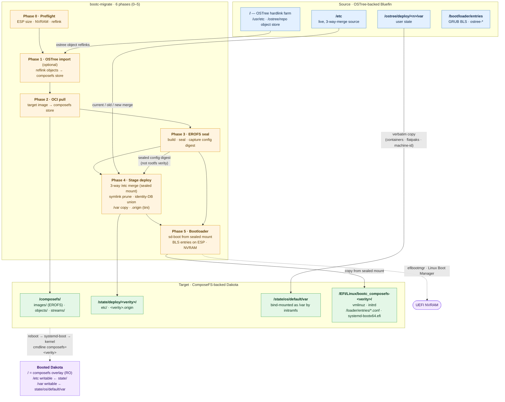

# bootc-migrate

[](https://github.com/tuna-os/bootc-migrate/actions/workflows/ci.yml)
[](https://github.com/tuna-os/bootc-migrate/actions/workflows/e2e-tests.yml?query=branch%3Amain)

In-place conversion tool for an OSTree-backend bootc system (for example,
Bluefin) to a ComposeFS-backend bootc system (for example, Dakota). It keeps
`/home`, `/var`, and `/etc` customizations, flatpaks, container storage, and
user accounts.

<!-- hive-contribute-plea: donated-compute appeal, keep in sync across repos -->
## Contribute compute — no code needed

**[Donate time with your AI CLI](https://hub.tunaos.org/#contribute).**

Your machine runs one task at a time using your signed-in AI coding CLI.
The relay alternates between eligible **School** (OS) and **Reef** (apps)
hives after each task. If one hive has no work, the other can continue.

The guide covers prerequisites, verified `just` setup, credentials, provider
costs, and how to stop with Ctrl+C. Your subscription quota or API charges apply.
Never post account credentials or API keys in issues or pull requests.

## Migrate Bluefin → Dakota (quick start)

The common case: **Bluefin stable (btrfs) → Dakota stable**. Five steps. Your
old OSTree deployment stays in the boot menu as a fallback the whole time.

> ⚠️ **Back up anything you can't afford to lose first.** This rewrites how your
> system boots. It preserves `/home`, `/var`, `/etc`, flatpaks, container
> storage, and user accounts — but treat it as risky until you've rebooted and
> confirmed everything works. It's reversible until you run `commit` (step 5).

**1. Get the migrator.** Download the latest prebuilt binary. Use
`x86_64-unknown-linux-gnu` on x86_64, `aarch64-unknown-linux-gnu` on arm64
glibc systems, or `aarch64-unknown-linux-musl` on arm64 musl systems such as
postmarketOS and Alpine:

> **Release-naming note.** The project name changed from
> `bootc-migrate-composefs` to `bootc-migrate` after v0.2.0.
> `release.yml` already publishes under the new name. From **v0.6.0**, the
> tarball, binary, and container image are all `bootc-migrate`. The commands
> below reflect that. To install older v0.2.0 artifacts, substitute
> `bootc-migrate-composefs` in the paths.

```bash
curl -fsSL -o bmc.tar.gz \
  https://github.com/tuna-os/bootc-migrate/releases/latest/download/bootc-migrate-x86_64-unknown-linux-gnu.tar.gz
tar xzf bmc.tar.gz
sudo install -m755 bootc-migrate /usr/local/bin/bootc-migrate
sudo install -m755 bootc-rebase /usr/local/bin/bootc-rebase
```

On Bluefin LTS, `/usr/local` is part of the read-only `/usr`, so the
`install` commands fail. Run the binaries from the directory where you
unpacked them instead (`sudo ./bootc-migrate …`). Nothing later needs them on
`PATH`: the bootloader resync hook keeps its own copy under
`/var/lib/bootc-migrate/bin`.

<details><summary>…or pull the container image</summary>

A minimal image ships the same binary, useful when GitHub Releases is rate-limited/blocked, or to `COPY --from=` it into another Containerfile:

```bash
podman create --name bmc-extract ghcr.io/tuna-os/bootc-migrate:latest
podman cp bmc-extract:/usr/local/bin/bootc-migrate .
podman rm bmc-extract
sudo install -m755 bootc-migrate /usr/local/bin/bootc-migrate
```
</details>

<details><summary>…or build from source (needs Rust)</summary>

```bash
git clone https://github.com/tuna-os/bootc-migrate
cd bootc-migrate
cargo build --release
sudo install -m755 target/release/bootc-migrate /usr/local/bin/
```
</details>

**2. Dry-run** — makes no changes; checks your system is ready:

```bash
sudo bootc-migrate \
  --target-image ghcr.io/projectbluefin/dakota:stable --dry-run
```

**3. Migrate** (~5–25 min based on cache/network):

```bash
sudo bootc-migrate \
  --target-image ghcr.io/projectbluefin/dakota:stable
```

**4. Reboot** — the new composefs entry is the default. If anything looks wrong,
pick the old **Bluefin / OSTree** entry in the boot menu to get straight back.

```bash
sudo systemctl reboot
```

**5. Confirm, then make it permanent:**

```bash
cat /proc/cmdline | grep -o 'composefs=[0-9a-f]*'   # confirms composefs boot
sudo bootc-migrate commit                 # one-way; removes the OSTree fallback
```

> **Note:** Phase 4 copies `/var` to the composefs side. The two `/var`
> trees are **independent** after migration. Changes on the composefs side do
> not appear after an OSTree rollback, and the reverse also applies. Commit only
> when you're satisfied with the new system.

For flags, rollback, problems, and the full phase-by-phase breakdown, see
[Usage — end-to-end walkthrough](#usage--end-to-end-walkthrough).
On **Bluefin LTS** (XFS) or systems with **LVM / LUKS / a dedicated `/var`
partition**, the tool handles those automatically — see
[docs/filesystem-support.md](docs/filesystem-support.md).

> **Status: CI-validated, released, and proven on real hardware.** Seven E2E
> scenarios — btrfs, ext4, LUKS+XFS, LVM-on-LUKS with a dedicated `/var`, two
> ostree re-bases, and a TUI-driven migration — run in CI on every push to
> `main` (migration, commit, deep-clean, and `bootc status` /
> `upgrade --check` all green). Prebuilt binaries are on the
> [Releases](https://github.com/tuna-os/bootc-migrate/releases) page. Don't point this at a machine you can't
> reinstall, but the core path is stable.

## Interactive wizard (TUI)

Prefer a guided walkthrough? Run `bootc-migrate` with no `--target-image`
or with `tui` to open the terminal wizard. It guides target image selection,
options, the review, and live phase logs:

```bash
sudo bootc-migrate tui
```


The image picker fetches the latest CI-published catalog, then uses a cached
or bundled JSON snapshot if offline. It lists published Bluefin, Universal
Blue, TunaOS, and Zirconium images. Utah stays marked as coming soon until its
registry tag appears. You see the selected image reference and backend before
you continue. OSTree targets use `bootc-rebase`, which you must install
alongside `bootc-migrate`; ComposeFS targets use the normal migrate path. The
tool does not support a return from ComposeFS to OSTree.

The wizard starts in dry-run mode. Press Enter to accept each screen, use ↑/↓
to choose an image, and press Space on the options page to change a setting.
For a live run, turn off dry-run there. The final review needs `CONFIRM` and
Enter before anything changes. You need root for a migration, but you can
browse the catalog without it.

## Coming from a regular (non-bootc) install

Fedora, Ubuntu, Debian, and Arch installs use package managers such as rpm, dpkg, or pacman.
These systems are package hosts, not bootc deployments.
`bootc-rebase` detects the source and selects the package → OSTree route.
The TUI shows the same route, limits the image picker to OSTree targets, and keeps the run read-only.

> **Current status: preview only.** The `PackageInstall` engine does not exist yet
> ([#373](https://github.com/tuna-os/bootc-migrate/issues/373)). Run the readiness preview, but do not treat it as a migration:

```bash
sudo bootc-rebase rebase \
  --target-image quay.io/fedora/fedora-bootc:latest \
  --target-backend ostree \
  --dry-run
```

The preview shows two reports. One covers the package host; the other covers target hardware.
It checks UEFI boot, the root filesystem and subvolume layout, LUKS/LVM, `/boot`,
`/home`, free space, active package transactions, and SELinux.
The [support matrix](docs/support-matrix.md#package-based-source-hosts) records evidence for each source distribution, filesystem, and boot mode.

The completed route will use this contract:

- The bootc deployment carries user accounts, home directories, application data, and user-modified `/etc` files.
  It uses the target image's default for unmodified package-owned configuration.
- Host packages do **not** carry.
  The software report ([#377](https://github.com/tuna-os/bootc-migrate/issues/377)) lists missing packages, third-party repositories, services, and kernel modules.
  It also lists Flatpak, Homebrew, toolbox/distrobox, or derived-image replacements.
- The old package OS stays bootable as **Previous system** until commit.
  [#374](https://github.com/tuna-os/bootc-migrate/issues/374) tracks creation and removal of that rollback entry.
- Use a separate one-way commit. After you verify the new deployment,
  [#378](https://github.com/tuna-os/bootc-migrate/issues/378) guides commit and reclaims the old OS.
  The existing `bootc-rebase commit` supports only composefs → OSTree.
  Do not use it for the package-host route.

## Architecture



**Key insight:** Phase 3 runs `bootc internals cfs oci seal` and prints the
sealed manifest's config digest. Phases 4 and 5 pass that **sealed config
digest** (not rootfs verity) to `bootc cfs oci mount`. The overlay exposes
`/etc`, kernel, initrd, systemd-boot, and kernel modules without another OCI
layer stream.

## What it does

Six phases (numbered 0–5 to match the console output), run as one command:

- **Phase 0 — Preflight** — free-space, reflink/CoW, UEFI, NVRAM-writable, ESP
  capacity.
- **Phase 1 — OSTree import** *(optional)* — reflinks OSTree file objects into
  the composefs store. This reduces duplicate data in Phase 2. Skip it with
  `--skip-import`.
- **Phase 2 — OCI pull** — `bootc internals cfs oci pull` of the target bootc
  image into the composefs store.
- **Phase 3 — EROFS seal** — builds and seals the EROFS image. It saves the
  sealed config digest for Phases 4 and 5.
- **Phase 4 — Stage deploy** — merges `/etc` and unions identity
  database lines. It reads from the sealed mount and removes broken
  `/usr/*` symlinks. It keeps `/home` ↔ `/var/home` compatibility and
  preserves `/var`. `.origin` stores `boot_digest` and `manifest_digest`;
  `tini` writes it.
- **Phase 5 — Bootloader** — copies `systemd-bootx64.efi` from the sealed
  mount to the ESP. It verifies that the target kernel resolves current
  wireless devices. It writes BLS entries and adds a stateroot mount argument
  for dedicated `/var`. It registers `Linux Boot Manager` in UEFI NVRAM. The
  original GRUB entry stays as a rollback escape hatch.

After a successful reboot into the composefs entry, `bootc-migrate
commit` removes the OSTree fallback and makes composefs permanent.

## Usage — end-to-end walkthrough

> **Before you start.** This tool rewrites bootloader state and either reuses
> or copies the entire `/var`. Don't run it on a machine you can't reinstall
> in a pinch.
> Until you run `commit`, it's reversible — but a fresh backup is still
> cheap insurance.

### 1. Decide your target

The migration takes a `--target-image` — the composefs-backed bootc image
you want to end up on. Today the validated path is **Bluefin → Dakota**:

```
ghcr.io/projectbluefin/dakota:stable     # default target
```

If you're migrating a different OSTree-backed system (Aurora, Silverblue),
point `--target-image` at the composefs-flavored equivalent.

The target must share a base lineage with the source: its `ID_LIKE` must
overlap yours, or both images must ship the same package manager. Bluefin,
Silverblue and CentOS-based images are all one dnf family. The tool
refuses a target from another family, for example Fedora → openSUSE,
because the standard `/etc` merge would carry your Fedora configuration
onto openSUSE. Pass `--accept-cross-base` to migrate with the cross-family
`/etc` policy instead. See "Cross-family targets" below.

To migrate to an image you built yourself instead of a published one, see
[docs/local-images.md](docs/local-images.md). Serve it from a registry the
machine can reach. An image that exists only in podman storage is not
enough. The capability scan and the Phase 4/5 fallbacks read the target
over the registry API.

### 2. Check readiness with a dry-run

```bash
sudo bootc-migrate \
  --target-image ghcr.io/projectbluefin/dakota:stable \
  --dry-run
```

Things to confirm in the report:

- `Booted bootc backend: ostree` — the conversion runs from here. `composefs`
  means the conversion is already done, and the tool swaps the deployment
  image instead (`bootc switch`) rather than refusing. Only `none` — not a
  bootc deployment at all — is a blocker.
- `UEFI Boot Mode: Yes` + `NVRAM writable: Yes` — required for the
  systemd-boot path; on BIOS-only or locked NVRAM pass `--bootloader grub2`.
- `ESP Free Space: ≥ 150 MB` — we copy `systemd-bootx64.efi` from the
  target image onto the ESP.
- `Reflink (CoW) Support: Yes` — btrfs and XFS both support reflink.
- `ComposeFS free space` includes the source OSTree import, two expanded
  copies of the target image (ComposeFS and podman fallback storage), and 5 GiB
  of temporary headroom for the initrd rebuild.

Optionally, preview what Phase 4's `/etc` merge will see before you run it:

```bash
sudo bootc-migrate etc-drift
```

Lists every path where your live `/etc` has diverged from the OSTree factory
default (added/modified/removed/type-changed), read-only. Useful for
spotting a stale customization you no longer need before it carries forward
into the migrated system.

### 3. Run the migration

```bash
sudo bootc-migrate \
  --target-image ghcr.io/projectbluefin/dakota:stable
```

Expect ~5–10 minutes on warm caches, ~15–25 minutes on a cold pull. Six
phase headers (0–5) print as it goes:

| Phase | What's happening | Why it might take a while |
|---|---|---|
| **0 — Preflight** | Same checks as `--dry-run` | seconds |
| **1 — OSTree import** *(optional)* | Reflinks existing OSTree file objects into the composefs object store so Phase 2 mostly dedups | tens of seconds to a few minutes; skip with `--skip-import` |
| **2 — OCI pull** | `bootc internals cfs oci pull` of the target image | minutes (network-bound) |
| **3 — EROFS image** | Builds + fs-verity-signs the composefs metadata image | seconds |
| **4 — Stage deploy** | 3-way `/etc` merge (from sealed mount) or, across families, the cross-family policy; dangling-symlink prune, identity-DB line-union, `/var` copy or dedicated-subvolume preservation, `.origin` file written | ~1 minute |
| **5 — Bootloader** | Copies systemd-boot from mounted image, writes BLS entries, registers NVRAM | ~30s |

When it ends with `=== MIGRATION COMPLETED ===` the on-disk state is
ready. Reboot:

```bash
sudo systemctl reboot
```

### 4. Validate the composefs boot

Log in (your existing accounts and SSH keys still work) and check:

```bash
cat /proc/cmdline                                       # must contain composefs=<hex>
bootc status                                            # should report the composefs deployment
bootc status --json | jq .status.booted.composefs        # non-null
```

Spend a day on it. Run your usual workflow — flatpaks, dnf, containers,
homebrew, GNOME extensions, whatever. Everything that lived under `/home`,
`/var`, and `/etc` on Bluefin should be where you left it. If something
is missing or broken, you can roll back (see below).

A login banner (`/etc/motd.d/85-bootc-migrate`) reminds you to run
`commit` on every login until you do, so a live migration doesn't sit
forgotten in this dual-boot state indefinitely. It clears itself once
`commit` runs — or once `undo` runs, since at that point there's nothing
left to commit.

### 5. Make it permanent (one-way)

Once you trust the new system:

```bash
sudo bootc-migrate commit
```

This removes the OSTree fallback from the ESP, drops GRUB2 boot artifacts,
and reclaims ~14 GiB of OSTree object store. The systemd-boot entry becomes
the sole default with timeout 0.

### Flags

| Flag                  | Purpose                                                            |
| --------------------- | ------------------------------------------------------------------ |
| `--dry-run`           | Print every action; touch nothing                                  |
| `--skip-import`       | Skip phase 1 (faster when target image is mostly new content)      |
| `--bootloader grub2`  | Stay on GRUB2 instead of installing systemd-boot                   |
| `--skip-preflight`    | Bypass preflight checks (don't, unless you know exactly why)       |
| `--force`             | Proceed past non-fatal warnings                                    |
| `--accept-cross-base` | Migrate to a target from another OS family with the cross-family `/etc` policy (see below). `--force` does not imply it |
| `--accept-hardware-gaps` | Migrate although the hardware check (see below) expects hardware that works today to stop working. `--force` does not imply it |

### Hardware and firmware check

The target image replaces your kernel, its modules and your firmware. Before
the tool changes anything, it compares your hardware with the target. The
`bootc-rebase scan <image>` command shows the same report.

The tool examines the PCI, USB, SDIO, virtio and HID devices. It examines
only the devices that use a loadable kernel module now. It does these checks:

- **Drivers.** The target must ship the same module, or a module that
  claims the device.
- **Out-of-tree drivers.** These are drivers like NVIDIA, VirtualBox and
  ZFS. The target can omit one of them. Then the report names the in-kernel
  driver that replaces it (for NVIDIA, `nouveau`) and what you lose.
- **Firmware.** For each module, the tool lists the firmware files that
  your machine has. The target must ship at least one of them.
- **CPU microcode.** Your machine can have microcode updates for its CPU.
  Then the target must also have them.

Each result has a level:

- `[BLOCKING]`: the tool refuses to migrate. A storage, display, network,
  wireless or USB controller loses its driver or all of its firmware. Or an
  out-of-tree driver has no in-kernel replacement. To continue anyway, use
  `--accept-hardware-gaps`. A better fix is an image variant that supports
  the hardware, for example an `-nvidia` image.
- `[WARNING]`: something can stop, but the migration continues. A display
  controller without its driver is a warning when the target kernel has a
  firmware framebuffer driver (`simpledrm`, `efifb`). The screen then works,
  but without graphics acceleration and at the firmware resolution.
- `[note]`: information only.

When the tool cannot read the target image, it tells you and continues. In
this case, it did not check your hardware. Some image layers can be
unreadable. Then no result blocks the migration, because the missing data
can hide what the image ships.

### Cross-family targets

`bootc-migrate` reads the target image's `os-release` and looks for its
package manager before it stages anything. Two images are one family when
their `ID`/`ID_LIKE` sets overlap or when both ship the same package
manager (dnf, zypper, apt, pacman or apk). When the sets share nothing and
the package managers differ (Fedora → openSUSE, Fedora → Debian), it
refuses. When one image ships no known package manager (Dakota is GNOME
OS-based), it warns and keeps the standard merge. The standard 3-way `/etc` merge keeps every file you
changed on the source. Across families, that carries one family's
package-manager, PAM, service and policy defaults onto the other.

With `--accept-cross-base`, Phase 4 applies the cross-family policy
instead:

- Every path the target ships takes the target's copy.
- The tool drops every path that only the source's vendor shipped.
- The tool keeps machine state verbatim: `fstab`, `crypttab`,
  `mdadm.conf`, `hostname`, `hosts`, `localtime`, `locale.conf`,
  `vconsole.conf`, `adjtime`, SSH host keys and `sshd_config.d/`, saved
  NetworkManager connections, and `sudoers.d/`. It also keeps every path
  you added yourself.
- Identity databases take the target's numeric ids first, and the tool
  appends your accounts. Password entries stay yours. The tool then
  changes the owner of each file under `/var` to match.
- Every displaced file you had changed stays beside its replacement as
  `<path>.rebase-old`. The tool deletes nothing.
- When the target enforces an SELinux policy that the source did not, a
  one-shot unit relabels `/etc` and `/var` on first boot.

The tool prints the report and writes it to
`/sysroot/state/deploy/<verity>/bootc-migrate-cross-family-report.json`.
This route is exploratory: one non-gating E2E cell exercises it. See
[ROADMAP.md](ROADMAP.md) and
[#256](https://github.com/tuna-os/bootc-migrate/issues/256).

### Move system Steam into Flatpak Steam

After installing and launching `com.valvesoftware.Steam` once, its per-user
data can absorb a system Steam installation without re-downloading games:

```bash
bootc-migrate system-to-flatpak-steam --dry-run
bootc-migrate system-to-flatpak-steam
```

Run it as the desktop user, **without** `sudo`, after closing Steam and all
Steam games. It uses filesystem renames only—never a recursive copy—to move
`steamapps`, `userdata`, and `config` from `~/.local/share/Steam` into Flatpak
Steam's data directory. The pre-existing Flatpak versions and both library
registries are retained in a timestamped rollback directory under
`~/.var/app/com.valvesoftware.Steam/`.

The command deliberately leaves the native Steam runtime files and unrelated
non-Steam folders such as `~/Games` alone. Add a Flatpak filesystem override
for `~/Games` separately if Steam shortcuts need it.

### Rollback / recovery

Until you run `commit`, the migration is **reversible**. The previous OSTree
deployment stays bootable:

- Phase 5 only *adds* the systemd-boot composefs entry; it never deletes the
  existing `/boot/loader/entries/ostree-*.conf` files.
- The original `/ostree/deploy/<n>/deploy/<commit>.0/` rootfs and
  `/ostree/deploy/<n>/var/` stay on disk.
- Phase 4 either copies `/var` to `state/os/default/var` or, for a dedicated
  filesystem/Btrfs subvolume, reuses it in place through a persistent BLS mount
  argument. The original data is not deleted during migration.
- We push `Linux Boot Manager` (systemd-boot) to the front of NVRAM `BootOrder`
  but the `Fedora` shim entry (which boots GRUB → OSTree) remains listed.

#### Automatic rollback subcommand

To return to the original OSTree deployment directly from the command line:

```bash
sudo bootc-migrate rollback --reboot
# or via the universal re-base CLI:
sudo bootc-rebase rollback --reboot
```

This verifies prerequisites, re-orders UEFI `BootOrder` so the OSTree entry (Fedora/GRUB) takes top priority, and reboots immediately into the OSTree deployment.

#### Manual firmware recovery

If the system fails to boot into composefs or NVRAM state is interrupted:

1. Power on; tap the firmware boot-menu key (commonly **F12**, **F8**, or **Esc**).
2. Pick the `Fedora` entry. GRUB will show the original `ostree:0` menu.
3. Boot it. You land on the pre-migration system with its `/var` and `/etc` intact.

Or, from a working composefs login, one-shot:

```bash
sudo efibootmgr -v | grep -E 'Fedora|Linux Boot Manager'
sudo efibootmgr --bootnext <Boot####-of-Fedora>
sudo systemctl reboot
```

Pre-migration diagnostic snapshots and logs are automatically recorded under `/var/log/bootc-migrate/` on every run (`preflight-*.json` and `migration.log`) so boot configuration can be manually reconstructed if NVRAM is ever wiped.

After running `bootc-migrate commit`, the OSTree fallback is removed
from the ESP and rollback becomes a fresh install. The E2E test exercises the
full round-trip (composefs → OSTree → composefs) on every run.

### First-boot repair

The migration stages a unit that runs one time on the first boot. It fixes
these known problems: carried home files with the wrong owner or time, a
duplicated machine-id, broken Flatpak installations, and SELinux labels.
Other findings stay as they are; the repair log reports them. To stop the
repair, run `sudo bootc-migrate repair --disable` before the reboot. See
[docs/first-boot-repair.md](docs/first-boot-repair.md).

### What's preserved

Validated end-to-end (21+ assertions per run; see `tests/run-e2e.sh`):

- **/var data** — `/var/lib/*`, `/var/log/*`, `/var/cache/*`, containers,
  flatpak system installs, machine-id, hidden dirs and symlinks
- **User homes** — `/var/home/<user>/`, dotfiles, project trees, SSH keys
  (with `.ssh` mode preserved so StrictModes still accepts your keys),
  wallpapers, GNOME extensions, dconf user db, glib gsettings keyfile,
  homebrew Cellar, per-user flatpak installs. When an OSTree source uses
  `/home -> /var/home` and the target has a native `/home`, both absolute path
  spellings remain valid through an ordered compatibility bind mount.
- **/etc state** — `/etc/sudoers.d/*`, `/etc/hosts` edits, custom
  `sshd_config.d/*`, custom config files added under `/etc/`, in-place
  edits to image-shipped files (`/etc/hostname`), `/etc` symlinks
- **Accounts** — `/etc/passwd`, `/etc/shadow`, `/etc/group` line-union
  merged so users you added survive *and* users the target image needs
  (messagebus, polkitd, …) get added

What's intentionally *not* carried forward:

- OSTree/rpm-ostree state markers (`.updated`, `.rpm-ostree-shadow-mode-fixed2.stamp`)
- GRUB2 config files (`grub2.cfg`, `grub2-efi.cfg`, `/etc/grub.d/`) — the
  target uses systemd-boot
- Source-image `/etc` files the target image removed (e.g. `sshd_config.d/40-redhat-crypto-policies.conf`
  which references `/etc/crypto-policies/` paths Dakota doesn't ship)

### Troubleshooting

| Symptom | Likely cause | Fix |
|---|---|---|
| Phase 0 refuses with "System is not booted into a bootc deployment" | Neither an ostree nor a composefs deployment is booted | Nothing to migrate from; check `bootc status` |
| Phase 0 refuses with insufficient free space | The root cannot hold the source import, ComposeFS target, podman fallback copy, and initrd rebuild headroom | Free space or grow the partition, then rerun |
| Post-reboot `cat /proc/cmdline` shows `ostree=` not `composefs=` | Firmware ignored the new NVRAM entry, or OVMF loaded `Fedora\shim` instead | Use firmware boot menu to pick `Linux Boot Manager`; if that fails, fall back to OSTree and report the firmware quirk |
| `bootc status` says "No manifest_digest in origin" | You're on an old build of this tool | Update to `main` — version info is on the first line of the migration log |
| SSH key auth broken post-migration | Permissions changed during /var copy | Boot OSTree fallback and `chmod 700 ~/.ssh; chmod 600 ~/.ssh/authorized_keys` |
| GNOME boots but session settings (wallpaper, accent) look wrong | dconf database needs recompile | `dconf update` as your user, or log out + back in |
| Phase 5 refuses because the target kernel has no module alias for a wireless device | The image omits the driver for Wi-Fi hardware present on the source system | Fix or update the target image. Use `--force` only when alternate networking is available and losing Wi-Fi is acceptable |
| Refused with "hardware that works on this machine today is expected to stop working" | The target image does not ship a driver or firmware that your storage, display, network or wireless hardware uses, or an out-of-tree driver such as NVIDIA | Read the `[BLOCKING]` lines. Pick an image variant that supports the hardware, or re-run with `--accept-hardware-gaps` to accept the loss |
| Refused with "Cross-family re-base detected" | The target's `ID_LIKE` shares nothing with the host's and its package manager differs | Re-run with `--accept-cross-base` to use the cross-family `/etc` policy, or pick a target from the same family |
| The new image boots, but `/etc` still looks like the old distribution | A cross-family migration ran with a build that predates #256 | Update the tool, boot the OSTree entry, and migrate again with `--accept-cross-base` |
| Phase 2 fails with "podman could not refresh" on your own image | The machine cannot pull the image, or podman rejects a plain-HTTP registry | Mark the registry insecure and confirm with a manual `podman pull` — see [docs/local-images.md](docs/local-images.md) |
| Migration went wrong and you want to undo it | Something failed mid-migration | Run `sudo bootc-migrate undo` (removes composefs boot artifacts, keeps object store) or `sudo bootc-migrate undo --full` (full cleanup including object store); then reboot into OSTree |

## Requirements

- Booted on an OSTree-backed bootc system (Bluefin, Aurora, Silverblue…)
- UEFI firmware with writable NVRAM (for the systemd-boot path; GRUB2 fallback
  works on BIOS)
- Btrfs or XFS sysroot with reflink/CoW support
- ESP with ≥150 MB free
- ≥ `1.1 × ostree_repo_size` free on `/sysroot/composefs` (no reflink: 1.5×)
- Outbound registry access for `bootc internals cfs oci pull`
  (Phase 2 fetches the target image; Phases 4–5 read artifacts from the sealed
  mount, so no runtime registry access is needed after Phase 2). A registry on
  your own network works too — see
  [docs/local-images.md](docs/local-images.md)

## Building

```
cargo build --release
```

Drops a single binary at `target/release/bootc-migrate`.
Requires Rust 1.85+ and a Linux host with `libxkbcommon-dev`.

## End-to-end tests

A QEMU-based E2E harness lives in `tests/run-e2e.sh`. It either installs an
OSTree/ComposeFS base image with bootc or, for `E2E_MODE=package-install`,
boots an official Fedora Cloud or Ubuntu Cloud disk prepared by
`tests/package-base.sh`, runs the package → OSTree migration, reboots, and
validates the target plus its `Previous system` entry.

```
sudo ./tests/run-e2e.sh
```

Overridable via env: `BASE_IMAGE`, `TARGET_IMAGE`, `DISK_SIZE`,
`FILESYSTEM`, `E2E_MODE`, `E2E_PACKAGE_BASE`, and
`E2E_PACKAGE_CROSS_FAMILY`.

The full matrix is authoritative in `.github/e2e-scenarios.yml`. It runs
nightly; each PR and push to `main` runs a round-robin slice of the gating
cells (see [docs/testing.md](docs/testing.md)):

| Cell | Base → target | Filesystem | Disk |
|---|---|---|---|
| composefs migration | bluefin:stable → dakota:stable | btrfs | 40G |
| composefs migration | bluefin:lts → dakota:stable | ext4 | 40G |
| composefs migration | bluefin:lts → dakota:stable | xfs+crypt | 40G |
| composefs migration | bluefin:lts → dakota:stable | xfs+lvm+crypt | 60G |
| ostree re-base | bluefin:stable → dakota:stable | btrfs | 40G |
| ostree re-base, GNOME→KDE (non-gating) | bluefin:stable → aurora:stable | btrfs | 40G |
| TUI-driven migration | bluefin:stable → dakota:stable | btrfs | 40G |
| cross-family migration (non-gating) | bluefin:stable → bootcrew/opensuse-bootc:latest | btrfs | 40G |
| cross-family migration (non-gating) | bluefin:stable → bootcrew/debian-bootc:latest | btrfs | 40G |
| cross-family migration (non-gating) | bluefin:stable → bootcrew/ubuntu-bootc:latest | btrfs | 40G |
| cross-family migration (non-gating) | bluefin:stable → bootcrew/arch-bootc:latest | btrfs | 40G |
| composefs → ostree (non-gating) | dakota:stable → fedora-bootc:44 | btrfs | 40G |
| composefs → ostree, Dakota → Utah (non-gating) | dakota:stable → utah:testing | btrfs | 40G |
| composefs image swap (non-gating) | dakota:stable → utah:testing | btrfs | 40G |
| tunaOS desktop ring, ostree re-base with `--de-migrate` (4 cells, non-gating) | albacore gnome → niri → cosmic → xfce → gnome | btrfs | 40G |
| package install (exploratory) | Fedora Cloud → fedora-bootc:43 | btrfs | 40G |
| package install (exploratory) | Fedora Workstation → Bluefin | btrfs + separate /boot | 60G |
| package install (exploratory) | Ubuntu Cloud → fedora-bootc:43 (cross-family) | ext4 | 40G |

Only the two `xfs*` cells exercise the ext4-loopback composefs store (XFS has
no fs-verity); btrfs and ext4 seal in place.

## Layout

A Cargo workspace with three crates (see [ROADMAP.md](ROADMAP.md) for why):

- `crates/bootc-migrate-core` — the capability library everything else is
  built from: phases, preflight/readiness, `/etc` merge (`mergetc`), OSTree
  object scan, registry streaming, transaction (`commit`/`undo`), target-image
  capability scan (`scan`), cross-base UID/GID remap (`remap`), UEFI boot-entry
  audit (`boot_audit`), DE detection (`de_detect`) and config stash/restore
  (`de_migrate`), types.
- `crates/bootc-migrate` — **the protected MVP binary** described
  above. CLI surface (clap), `commit`/`undo`/`rollback` subcommands, the TUI
  wizard. Its E2E cells are untouchable regression gates — this binary's
  behavior doesn't change as new capability lands in `bootc-rebase`.
- `crates/bootc-rebase` — the universal re-base engine binary; see below.
- `tests/run-e2e.sh` — QEMU E2E harness exercising both binaries.

## `bootc-rebase` — the universal re-base engine

`bootc-migrate` above does one proven thing: OSTree → ComposeFS.
`bootc-rebase` is the generalization — a routing table over
**backend × strategy** that will eventually cover every bootc re-base shape
(same-backend image swaps, cross-backend conversions, bootloader changes,
cross-distro-family moves, desktop-environment switches). It's newer and less
battle-tested than the MVP binary; treat subcommands marked *skeleton* or
*read-only* below as previews, not yet full features.

```bash
cargo build --release -p bootc-rebase
```

| Subcommand | What it does | Status |
|---|---|---|
| `scan <image>` | Registry-streamed capability probe of a target image — composefs/ostree readiness, fs-verity requirement, transient root/etc, bootloader payload, desktops, base OS identity, sysusers, initramfs flavor, filesystem expectation, and a `Compatible: YES/NO` verdict with reasons. On a package host it also compares installed software with the target image. `--json` includes the software report for machine consumers. | Done |
| `rebase --target-image <image>` | Re-base the running system, routing on `--source-backend`/`--target-backend` through the strategy table below. `--plan` prints the route, selected phases, and bootloader policy, then exits without touching the system. | Implemented for ostree→composefs (the MVP pipeline), composefs→composefs (image swap), ostree→ostree (native `bootc switch`, with cross-base UID/GID remap when host and target disagree on distro family — pass `--accept-cross-base` to proceed past the report), and composefs→ostree (`OstreeInstall`, #260: the target's own `bootc install to-existing-root` builds an OSTree deployment beside the composefs root; `/etc` merged, `/var` copied, composefs ESP artifacts restored and its firmware entry kept as rollback; exploratory, one non-gating cell). On the composefs routes `--accept-cross-base` also accepts a cross-*family* target and, on the conversion route, selects the cross-family `/etc` policy (#256) |
| `rollback [--reboot]` | Re-order UEFI `BootOrder` back to the previous deployment. | Done |
| `boot-entries [--json] [--interactive] [--rename-branding] [--apply] [--undo]` | Enumerate and classify UEFI boot entries: dead (loader path missing), generic-label, duplicate, firmware-managed, plus which are protected and why. **Dry-run by default** — a bare invocation is the read-only audit. `--interactive` opens a checklist (protected entries are unselectable), `--rename-branding` proposes renaming the booted entry to `PRETTY_NAME`, `--apply` writes the result to NVRAM after a typed confirmation and a restorable snapshot, and `--undo` replays that snapshot. | Audit and the cleanup **planner** are unit-tested (protections, the last-bootable-entry guard, and the "every entry looks dead ⇒ the ESP is wrong" refusal). The gating OSTree re-base E2E cell also renames a live OVMF NVRAM entry, applies the plan, undoes it, and asserts byte-identical `efibootmgr -v` output. This covers the executor and snapshot restore; it does **not** cover the separate, unimplemented GRUB2→systemd-boot flip ([#31](https://github.com/tuna-os/bootc-migrate/issues/31), [#189](https://github.com/tuna-os/bootc-migrate/issues/189)) |
| `commit [--apply] [--yes] [--force]` | After a composefs → ostree re-base has booted, remove the composefs state it kept as rollback (#315). **Dry run by default**: checks that the system booted the OSTree deployment the install report names, that the ESP snapshot and a shim/GRUB firmware entry exist, and that every path of the old `/var` is present in the live `/var`. It then lists every path it would delete, with sizes. `--apply` deletes after a typed confirmation. First it copies the install report and ESP snapshot into the live `/var/lib/bootc-rebase`. Then it removes the old `/var`, the composefs store and the composefs deployments. It never touches the OSTree repo, `/boot`, the ESP or NVRAM. `--force` accepts failed checks. It never accepts a composefs boot or a filesystem mounted inside a path to delete. | Unit-tested against a fixture physical root. The non-gating composefs → ostree cell runs the dry run, then `--apply`, then reboots and checks system health |
| `de-migrate stash\|restore` | Move a user's desktop-environment config (GNOME dconf/gnome-shell, KDE kdeglobals/plasma, COSMIC, niri, XFCE) into or out of a stash directory around a cross-DE re-base — union of paths per issue [#68](https://github.com/tuna-os/bootc-migrate/issues/68), never deletes. `--run-hooks` executes `pre-switch.d`/`post-switch.d` scripts with `REBASE_FROM_DE`/`REBASE_TO_DE`/`REBASE_STASH_DIR`/`REBASE_HOME` set. `--dry-run` previews without touching anything. | Done. Also runs automatically inside `rebase --de-migrate`; this subcommand remains the manual escape hatch for images shipping several desktops (which detection refuses to guess between) |
| `rebase --de-migrate` | Detects the desktop environment the target image ships (registry-streamed session files, session binaries, and display-manager default session — no `podman pull`) and the one this host runs. When they differ, stashes every human account's outgoing DE config before staging and re-exposes any stash a previous re-base in the other direction left behind, running the `pre-switch.d`/`post-switch.d` hooks around each. | Done, unit-tested; **off by default** — a re-base never touches per-user desktop state unless asked to. The non-gating Bluefin→Aurora E2E cell passes `--de-migrate`, seeds GNOME config, and asserts that the cross-DE plan and stash are created. Because target desktop detection uses the registry scan, this evidence depends on that exploratory cell completing successfully ([#68](https://github.com/tuna-os/bootc-migrate/issues/68), [#188](https://github.com/tuna-os/bootc-migrate/issues/188)) |
| `migrate-bootloader --to systemd-boot [--promote\|--undo] [--from-image <image>]` | GRUB2 → systemd-boot conversion, standalone of a backend re-base. | **Implemented** — stages every existing deployment on the ESP, installs systemd-boot, creates a one-boot `BootNext` trial without changing `BootOrder`, and installs a `kernel-install` resync hook. If the host does not ship `systemd-bootx64.efi`, `--from-image <image>` supplies a registry-reachable image to extract it from. `--promote` requires that the running system booted from the trial before making it persistent; `--undo` restores the prior firmware order and removes only the migration-owned files. The `bootloader-trial` QEMU cell covers the OVMF BootOrder swap, reboot, resync, promotion, and undo path. |

`rebase`'s routing table (`crates/bootc-migrate-core/src/rebase_plan.rs` is the single
source of truth the CLI consults before touching anything):

| From ↓ \ To → | ostree | composefs |
|---|---|---|
| **ostree** | `OstreeDeploy` (native `bootc switch`) | `CoreMigration` (this repo's proven phase 0–5 pipeline) |
| **composefs** | `OstreeInstall` (the target's own `bootc install to-existing-root`, alongside; composefs entry kept as rollback — #260, exploratory) | `ImageSwap` |
| **package** | `PackageInstall` (the shared alongside-install engine binds `/` at `/target`, carries root kernel arguments, and snapshots the old `/boot` — #373) | Two steps: package → ostree, then ostree → composefs |

A **package** source is a system that is not a bootc deployment: a regular
Fedora, Ubuntu or Arch installation. `rebase` finds one by its rpm, dpkg or
pacman database when `bootc status` names no deployment and the root has no
ostree or composefs state. On such a system, `--target-backend auto` (the
default) selects ostree. `PackageInstall` runs the target image's own `bootc
install to-existing-root` against the live physical root after readiness and
hardware gates pass. It snapshots the old kernels, initramfs, BLS entries and
GRUB configuration before bootc empties `/boot`; the `Previous system` entry
and guided package-host commit remain tracked by #374 and #378.

`--dry-run` on a package host also prints a readiness report and the
hardware report. The report refuses these systems and gives the reason for
each refusal:

- legacy BIOS boot (UEFI only for now);
- a root filesystem other than btrfs, xfs or ext4;
- a root, `/home` or `/boot` on LUKS or LVM;
- a btrfs root that is not a subvolume;
- too little free space for the image and the new deployment;
- a read-only root, or an active package manager.

SELinux disabled on the host gives a warning, because the first boot then
relabels all carried files.

The same registry pass extracts the target's rpm, dpkg or pacman inventory.
`scan` and package-host `--dry-run` compare it with the live host and group
packages the image lacks into desktop applications, CLI tools, system services,
kernel modules and other packages. Suggestions prefer a matching Flathub ID,
then a known Homebrew formula, a toolbox/distrobox, or a derived image.
Third-party package repositories and enabled services absent from the target are
listed separately. An incomplete registry pass suppresses absence claims rather
than treating missing evidence as an empty image.

A non-dry package-host invocation writes the machine-readable report and its
Markdown twin to `/var/lib/bootc-rebase/software-report.json` and
`/var/lib/bootc-rebase/software-report.md`. Dry runs and `scan` print the report
without changing the host.

## Roadmap

Full milestone plan, current status per issue, and design decisions live in
[ROADMAP.md](ROADMAP.md) — start there for "what's next" and "why did we
choose X over Y."

## Contributing

Contributions are welcome — see [CONTRIBUTING.md](CONTRIBUTING.md) for setup and
[REVIEW.md](REVIEW.md) for the code-review expectations. Run `just check` (clippy,
rustfmt, unit tests, shellcheck) before opening a PR. AI-assisted contributions
should follow [AGENTS.md](AGENTS.md).

## License

Licensed under either of [Apache License, Version 2.0](LICENSE-APACHE) or
[MIT license](LICENSE-MIT) at your option.

Unless you explicitly state otherwise, any contribution intentionally submitted
for inclusion in this project by you, as defined in the Apache-2.0 license, shall
be dual-licensed as above, without any additional terms or conditions.
